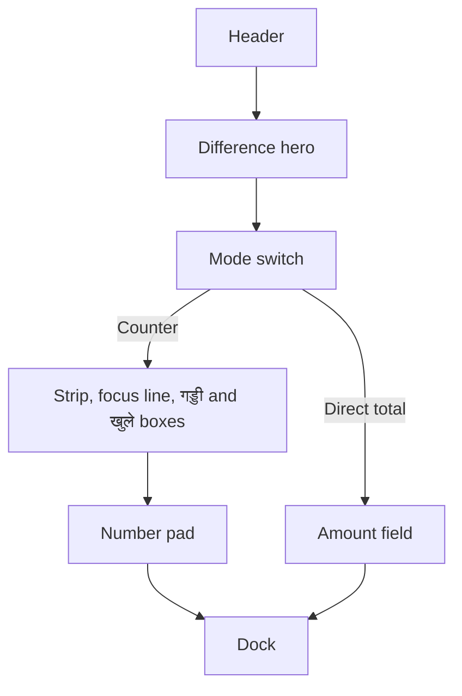
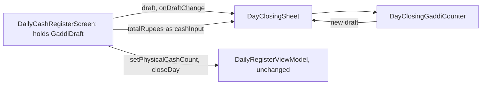

# Close day: Gaddi counter

Date: 2026-11-27. Vivek chose this design (Option C) on 2026-11-27. Status: ready to build, after the preconditions below. No app code has been written for it.

Mockup: `docs/mockups/close-day-concepts.html`, third phone ("C. Gaddi counter"). Open it in a browser. Where the mockup and this document differ, this document wins (see "Differences from the mockup").

## Preconditions

Check all three before editing code.

1. This design is based on local `main` at `7950dfd`, which is 6 commits ahead of `origin/main`. Those commits contain the current version of `DayClosingSheet.kt`. A branch cut from `origin/main` has an older sheet.
2. At 22:25 on 2026-11-27 `DayClosingSheet.kt` had an uncommitted change (`imePadding` on the sheet, conditional `navigationBarsPadding` on the dock), last written at 22:23. Another session may own it. Do not discard, stash or overwrite it. Build on it once it is committed.
3. Vivek decides how those 6 commits reach `origin` (open question below). Never push to `main`.

## Problem

- Each denomination row is about 70 dp tall on the Redmi, so 6 of 10 are visible.
- The shortfall, the most important number, sits in the smallest box.
- In note counting mode an empty count becomes `₹0`, so "दिन बंद करें" is enabled before anything is counted.
- The current sheet no longer shows `state.countError`, so a failed save is silent.
- Large piles are counted as bundles of 100 plus loose notes. The screen has no way to enter that.

## Decisions

- Count one denomination at a time, entered as गड्डी (bundle of 100) plus खुले (loose).
- A built-in number pad replaces the phone keyboard in counter mode.
- The difference is the headline.
- Nothing entered means "not counted". Both dock buttons are off.
- Closing with a difference requires a reason. Saving a count does not. Today the reason is optional, so this is new behaviour.
- Direct total entry stays, behind the existing two-tab switch.
- The existing close confirmation dialog stays.
- No change to the schema, sync, backend, receipts, WhatsApp report or `DailyRegisterViewModel`.

## Layout (counter mode)

Top to bottom. Only the middle area scrolls.

| Block | Height | Scrolls | Content |
|---|---|---|---|
| Header | 48 dp | no | Title, date, close icon (48 dp target) |
| Difference hero | about 90 dp | no | Verdict, progress bar, counted and expected |
| Mode switch | 40 dp | no | Existing segmented switch and strings |
| Denomination strip | 2 x 48 dp | yes | 5 x 2 chips, all ten denominations |
| Focus line | about 48 dp | yes | Selected denomination, pieces and amount |
| Entry boxes | about 72 dp | yes | गड्डी and खुले |
| Details, error | collapsed | yes | Existing accordion, save error text |
| Number pad | about 210 dp | no | Keys at least 48 dp high |
| Dock | about 64 dp | no | Save count, close day |

In direct total mode the strip, focus line, boxes and pad are replaced by the existing text field with the system keyboard.



## Behaviour

### Counter

- Opens on ₹500. ₹2000 is rarely present but stays in the strip.
- ₹5, ₹2 and ₹1 are coins: one box labelled गिनती, no bundle box. ₹10 and ₹20 keep both boxes.
- The खुले box is selected after choosing a denomination.
- The first digit after selecting a denomination or box replaces its value. Later digits append.
- गड्डी accepts 0 to 999. खुले accepts 0 to 9999 and is never converted into bundles. A digit that would pass the limit is ignored.
- Backspace removes the last digit. On an untouched denomination it does nothing.
- `+1` adds one to the selected box.
- `0 करें` sets the selected denomination to zero and marks it counted. It is also how an empty drawer is recorded.
- `पिछला` and `अगला` move through `2000, 500, 200, 100, 50, 20, 10, 5, 2, 1`. They are disabled at the ends and do not mark anything as counted.
- A chip shows `बाकी` until its denomination has an entry, then `× <pieces>`. The selected chip has a 2 dp border.
- Untouched denominations count as zero in the total.

### Difference hero

`diff = counted * 100 - state.inHandCashDrawerPaisa`, all in `Long` paisa.

| State | When | Hindi | English | Colour tokens |
|---|---|---|---|---|
| Not counted | no valid count | अभी गिना नहीं | Not counted yet | surface elevated, border |
| Short | diff < 0 | ₹X कम | ₹X short | `MandiAmberLight`, `MandiAmberBorder`, `MandiAmberDark` |
| Surplus | diff > 0 | ₹X ज़्यादा | ₹X over | amber, as above |
| Match | diff = 0 | हिसाब बराबर | Cash matches | `MandiGreenLight`, `MandiGreenBorder`, `MandiGreenText` |

- Each state has a vector icon. No emoji or text symbols such as `✓`.
- Show amounts with `MandiCurrencyFormatter.formatRupees`.
- The progress bar is `counted / expected`, capped at 100%. Hide it when expected is zero or negative.
- Expected cash can carry paisa while the count is whole rupees. The difference then shows the paisa, as today.

### Dock and reason

| Situation | Close button | Enabled |
|---|---|---|
| Not counted | पहले नकदी गिनें / Count the cash first | no |
| Match | दिन बंद करें / Close day | yes |
| Difference, reason blank | ₹X कमी (or बढ़त) के साथ बंद करें / Close with ₹X short (or over) | yes, opens the reason picker |
| Picker open, nothing chosen | कारण चुनें / Choose a reason | no |
| Difference, reason set | same label as row 3 | yes, opens the confirmation dialog |

- Opening the picker hides the pad and shows chips above the dock buttons: `खुले पैसे` (Change shortfall), `खर्च लिखना बाकी` (Expense not entered), `भुगतान बाकी` (Payment not entered), `अन्य` (Other).
- A chip writes its visible label into the existing `reason` string.
- `अन्य` shows a text field (`MandiKeyboard.Note`). Close stays off until it is non-blank.
- Choosing a denomination, switching mode or changing the count closes the picker and clears the reason.
- A match never saves a reason: the screen passes `reason` only when the count differs from expected.
- Save count (`गिनती सहेजें` / Save count) is enabled for any valid count and not while saving.
- Button colours do not change: close uses `MandiBtnSuccessBg` and `MandiBtnSuccessFg`.
- When `state.countError` is set, show "गिनती सहेजी नहीं गई। फिर कोशिश करें।" / "Could not save count. Please retry." above the buttons.

### Draft and reopening

- The counter draft survives closing and reopening the sheet while the register screen stays open, for the same date and the same `cashFingerprint`. A swipe down must not lose a half-finished count.
- A cash entry change (new `cashFingerprint`) or a date change clears the draft.
- The draft is not persisted. Leaving the screen or process death loses it.
- On open: counter mode if there is no saved count or the draft has entries. Otherwise direct total mode, prefilled with the saved count, because the denomination breakdown is not stored.
- "गिनती हटाएं" clears the draft as well as the saved count.

## Code design

All paths are under `composeApp/src/commonMain/kotlin/com/appwork/mandisamiti/ui/register/`.

| File | Change |
|---|---|
| `GaddiCounter.kt` (new) | Pure model and operations. No Compose imports |
| `DayClosingGaddiCounter.kt` (new) | Strip, focus line, boxes, number pad |
| `DayClosingSheet.kt` | Frame, hero, switch, picker, dock. Remove the stepper rows |
| `DailyCashRegisterScreen.kt` | Draft state and wiring (about lines 177 to 188 and 683 to 737) |
| `DrawerPresentation.kt` | Keep `drawerDenominations` and `denominationTotal`. Delete `adjustDenomination` once unused, with its test |



```kotlin
internal enum class GaddiField { BUNDLES, LOOSE }

internal data class GaddiCount(val bundles: Int = 0, val loose: Int = 0) {
    val pieces: Int get() = bundles * 100 + loose
}

internal data class GaddiDraft(
    val counts: Map<Int, GaddiCount> = emptyMap(), // a key means the denomination was counted
    val selected: Int = 500,
    val field: GaddiField = GaddiField.LOOSE,
    val replaceOnType: Boolean = true,
) {
    /** null means nothing has been counted. */
    val totalRupees: Long?
        get() = if (counts.isEmpty()) null
        else denominationTotal(counts.mapValues { it.value.pieces.toString() })

    // select(denomination), focus(field), digit(n), backspace(), addOne(), zero(), next(), previous()
    // each returns a new GaddiDraft
}
```

`DayClosingSheet` drops `denominationQuantities` and `onDenominationChange` and takes `draft: GaddiDraft` and `onDraftChange: (GaddiDraft) -> Unit`.

Screen state:

```kotlin
var gaddi by remember(uiState.selectedDate, uiState.cashFingerprint) { mutableStateOf(GaddiDraft()) }
var useDenominations by remember(uiState.selectedDate, uiState.isDayClosingSummaryOpen) {
    mutableStateOf(uiState.physicalCountPaisa == null || gaddi.counts.isNotEmpty())
}
```

- `onDraftChange`: store the draft, set `physicalCashInput = it.totalRupees?.toString().orEmpty()`, and clear the reason if `counts` changed.
- Switching to counter mode sets `physicalCashInput` from the draft the same way, so an empty draft gives an empty string, not `0`.
- `onCount` (about line 333): when the draft has entries, prefill `physicalCashInput` from the draft instead of the saved count.
- `denominationTotal(emptyMap())` keeps returning `0`. An existing test depends on it. The "not counted" rule lives in `totalRupees`.
- The pad needs `Icons.AutoMirrored.Filled.Backspace`. If it does not resolve, add a vector drawable. Do not use a text symbol.

## Accessibility and UI rules

- Colours only through the `Mandi*` aliases. Text contrast at least 4.5:1 in both themes. Measure the amber and disabled states.
- All targets at least 48 dp.
- Every pad key, chip and box has a spoken description, for example "500 के नोट, 3 गड्डी". The hero is a polite live region.
- Amounts use tabular figures.
- Hindi and English labels fit without clipping at 390 dp width and at font scale 1.3.
- No sound and no haptics.

## Differences from the mockup

- The mockup keeps खुले below 100. The app must accept any value up to 9999.
- The mockup shows गड्डी boxes for coins. The app does not.
- The mockup omits the mode switch, Details accordion, error line and the अन्य text field.
- The mockup wraps from ₹1 to ₹2000. The app disables the key at the ends.
- The mockup's "खाली करें" button is a demo control. Do not build it.

## Out of scope

- Storing the denomination breakdown.
- Fixing the fixed colour of `MandiBtnSuccessBg` across themes.
- Changes to `DrawerSummaryCard`, `TarajuBalanceScale` or the register list.

## Build order

1. `GaddiCounter.kt`.
2. Counter UI, then the sheet and screen wiring.
3. `./gradlew :composeApp:jvmTest` and `./gradlew :composeApp:assembleStagingDebug`.
4. Device check (below). Stop and get Vivek's approval.
5. After the flow is final: tests, `FEATURES.json` (new entry `close-day-gaddi-counter` at the end), `PROGRESS.md`, `docs/STATUS.md`.

## Tests (step 5)

- `GaddiCounterTest`: replace then append, caps, backspace on untouched, loose 137 stays 137, `zero()` gives total 0, empty draft gives null, end stops for next and previous, `2 गड्डी + 37` of ₹500 equals ₹118,500.
- Compose JVM test on `DayClosingSheet`: both buttons off when nothing is counted; reason picker blocks close until chosen; match closes without a picker; save error is visible. Run in Hindi and English with text bounds checked.

## Device check (Redmi `d93c743`, staging only)

Never point at `10.0.2.2`. Do not tap the final confirm in the close dialog, or Save count, without Vivek's approval, since both change staging data. Use "खुला रखें" to back out.

| # | Check |
|---|---|
| 1 | All ten chips, both boxes, the pad and the dock are visible with no scroll |
| 2 | Fresh open shows अभी गिना नहीं and both buttons off |
| 3 | Bundles and loose entries give the right total and difference |
| 4 | Swipe the sheet down, reopen: the draft is intact |
| 5 | A difference opens the reason picker; अन्य needs text |
| 6 | An exact match goes straight to the confirmation dialog |
| 7 | Direct total mode: keyboard does not cover the field or dock |
| 8 | Light theme, dark theme, Hindi, English, font scale 1.3 |

## Done means

All device checks pass on the dated Redmi run, JVM tests and the staging build pass, and Vivek has approved. Update `vaults/Vivek-K/wiki/hot.md` and the submodule pointer only after that. List anything not verified, including iOS (a known compile error in `ReceiptPrinter.ios.kt` blocks it).

## Open question

How should the 6 local `main` commits reach `origin`: as their own pull request first (recommended, keeps this change small), or inside this feature's pull request?
