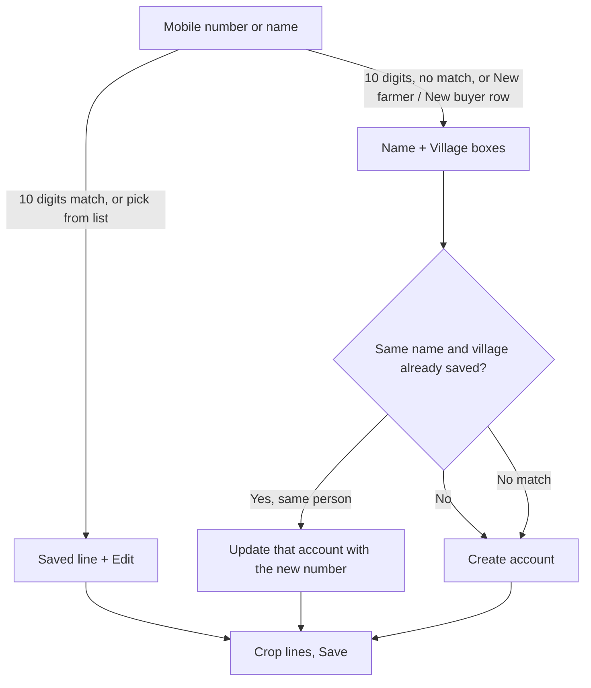

# Slip party block: show less for saved accounts (Buy and Sell)

Date: 2026-11-27. Approved by Vivek on 2026-11-27.

## Problem

Buy and Sell slips always show three boxes (mobile number, name, village). For a saved
account two of them are autofilled noise. Typing a different name over a saved account
renames it on every old slip. A new number for a saved person silently creates a second
account and splits the khata.

## Decisions

- The mobile number stays compulsory. Name and village stay required.
- A saved account shows a read-only line "name · village" with an Edit button.
- Name and village boxes appear only for a new account.
- Scope is Buy and Sell. Udhaar and Lend do not change.
- No schema, sync, backend or receipt change.

## Flow

## Screen states

| State | When | Shows |
|---|---|---|
| Lookup | Nothing typed, or fewer than 10 digits with no match | Search box only |
| Saved | Picked from the list, or number matches an account | Search box with the number, saved line, Edit |
| New | 10 digits with no match, or the "+ New" row was tapped | Search box, "new account" hint, name, village |

## Special cases

| Case | Behavior |
|---|---|
| Saved account has no number | The search box asks for the number. Save stays blocked. |
| Saved account has no village | A village box appears under the saved line. |
| Number changed after a match | Selection, name, village (and GSTIN, state code on Sell) are cleared. |
| Edit | A dialog edits name and village. The change reaches the account when the slip is saved, and applies to its old slips. Cancel changes nothing. |
| Different person on a saved number | The slip goes to the saved account. A separate account needs a separate number. |
| New number, same name and village as a saved account | Ask "Same person with a new number?" Yes updates that account. No creates a new one. |
| Old slip opened for editing | Saved line shows the account's current name, village and number. Slip values are used only where the account has none. |
| Khaate | No change. |
| Sell, Bill of Supply | GSTIN box stays where it is. |

## Out of scope, to report

`SellPartyResolver.partyToSave` saves every new Sell account as `PartyType.BUYER`, and
`SellPartyResolver.pick` switches any BUYER to Merchant. A saved retail customer therefore
comes back as Merchant on the next slip. Vivek decides separately. Do not fix it here.

## Testing

JVM tests for the state rules, then device checks on the Redmi against staging in light and
dark theme.
