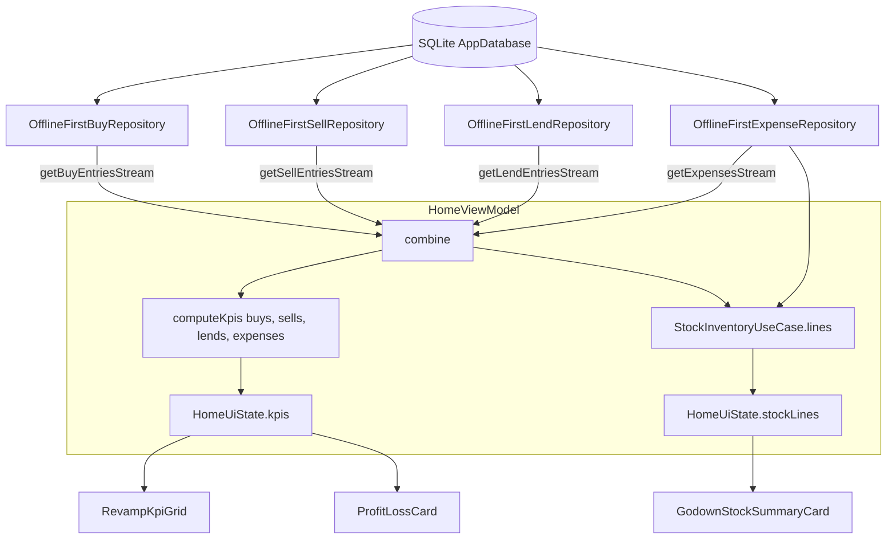

# MandiSamiti Revamp — Flow 03: Dashboard & Entry Points (डैशबोर्ड एवं सौदे के मुख्य द्वार)

## 1. Flow Overview & Scope
The Dashboard serves as the financial command center for the commission agent (आढ़ती). It aggregates real-time transactions from all four financial pillars (`Buy`, `Sell`, `Lend`, and `Expense`) and Godown inventory into high-trust visual indicators, while providing immediate 1-tap quick action entry points to create or view transactions.

---

## 2. Dashboard Components & Architecture

### A. Quick Action Entry Points (त्वरित सौदे के द्वार)
Replaces the single legacy CTA button with 4 distinct, color-coded, 48dp+ tactile action tiles:
1. **[खरीद / आवक]** (Green accent): 1-tap entry to New Buy Entry screen (`BuyEntryScreen` - S1).
2. **[बिक्री / जावक]** (Blue accent): 1-tap entry to New Sell Entry screen (`SellEntryScreen` - S4).
3. **[उधार / पेशगी]** (Orange accent): 1-tap entry to New Lend Entry screen (`LendEntryScreen` - S7).
4. **[खर्च / मंडी व्यय]** (Pink accent): 1-tap entry to New Expense screen (`ExpenseEntryScreen` - S10).

### B. Core Financial KPI Grid (4-Tile Metrics)
Each tile reflects live gross aggregates and deep-links to its dedicated transaction ledger:
1. **कुल खरीद (Gross Purchases):** Sum of non-void `BuyEntry.grossPaisa`. Tapping opens `BuyTransactionsListScreen` (S2).
2. **कुल बिक्री (Gross Sales):** Sum of non-void `SellEntry.grossPaisa`. Tapping opens `SellTransactionsListScreen` (S5).
3. **कुल उधार (बाकी) (Active Outstandings):** Sum of active money lends from `LendEntry`. Tapping opens `LendTransactionsListScreen` (S8).
4. **कुल खर्च (Operational Expenses):** Sum of all recorded business expenses. Tapping opens `ExpenseEntryScreen` (S10).

### C. Profit & Loss Card (शुद्ध लाभ / हानि) — Privacy Relocation
- To protect trader discretion and prevent bystander farmers or rival agents from viewing estimated margins in open mandi sheds, Profit & Loss is moved to the private Evening Day Closing Reconciliation (Galla) and owner Reports.

### D. Godown Stock Inventory (गोदाम स्टॉक) — Khata Tab Integration
- Relocated from the primary operational dashboard to the **खाता बही (Ledger)** tab.
- Accessible via a prominent **गोदाम स्टॉक (जिंस इन्वेंटरी)** tile right above the account filter chips, opening the complete commodity-by-commodity bought vs sold vs on-hand breakdown sheet (`StockBreakdownSheet`).

### E. Market Ledger Balance Cards
- **कुल लेना (बाजार बाकी):** Outstanding receivables from market parties.
- **कुल देना (किसान जमा):** Outstanding payables to farmers.

### F. Single Primary Entry Model
- Removed floating speed dial FAB overlay; the 4-tile QuickActionsRow serves as the sole, tactile entry point for transactions.

---

## 3. Real-Time Reactive Pipeline

---

## 4. Test Cases & Verification Matrix

| Case ID | Feature / Component | Action | Expected Output | Status |
| :--- | :--- | :--- | :--- | :--- |
| **TC-DASH-01** | Buy Gross Reflection | Complete Buy Flow transactions | `कुल खरीद` tile live-updates with exact gross total sum | **PASS on Device** |
| **TC-DASH-02** | Sell Gross Reflection | Complete Sell Flow transactions (Customer + Merchant) | `कुल बिक्री` tile live-updates with exact gross total sum | **PASS on Device** |
| **TC-DASH-03** | Profit/Loss Calculation | Purchases + Sales in DB | Profit/Loss card displays $(Sales - Purchases - Expenses)$ with correct label and color | **PASS on Device** |
| **TC-DASH-04** | Godown Stock Summary | Stock inventory calculation | Shows commodity balances in quintals; highlights oversold commodities with warning badge | **PASS on Device** |
| **TC-DASH-05** | Quick Action: Buy | Tap `[खरीद / आवक]` tile | Navigates directly to `BuyEntryScreen` (S1) | **PASS on Device** |
| **TC-DASH-06** | Quick Action: Sell | Tap `[बिक्री / जावक]` tile | Navigates directly to `SellEntryScreen` (S4) | **PASS on Device** |
| **TC-DASH-07** | KPI Deep Link: Buy List | Tap `कुल खरीद` card | Navigates directly to `BuyTransactionsListScreen` (S2) | **PASS on Device** |
| **TC-DASH-08** | KPI Deep Link: Sell List | Tap `कुल बिक्री` card | Navigates directly to `SellTransactionsListScreen` (S5) | **PASS on Device** |
| **TC-DASH-09** | Godown Stock Modal | Tap Godown Stock summary card | Opens `StockBreakdownSheet` (S11) modal with full inventory lines | **PASS on Device** |

---

## 5. Device Evidence & Screenshots (Redmi Note 7, Android 10)

| Screenshot Reference | Screen Name | Key Evidence Displayed |
| :--- | :--- | :--- |
| `docs/testing/evidence/dashboard/01_dashboard_revamp_live.png` | Live Revamped Dashboard | 4 Quick Action tiles (`खरीद`, `बिक्री`, `उधार`, `खर्च`), `कुल खरीद` ₹38,500, `कुल बिक्री` ₹90,000, `अनुमानित शुद्ध लाभ` ₹51,500, Godown Stock with oversold warning badges |
| `docs/testing/evidence/dashboard/02_buy_entry_nav.png` | Deep-link to Buy Entry / List | Tapping `खरीद` opens S1 Buy Entry screen with multi-crop lots |
| `docs/testing/evidence/dashboard/03_sell_list_nav.png` | Deep-link to Sell List | Tapping `कुल बिक्री` opens S5 Sell List showing Balaji, Ramesh Kumar, and Shree Ganesh BOS |
| `docs/testing/evidence/dashboard/04_stock_sheet_modal.png` | Godown Stock Inventory Sheet | Tapping Godown Stock card opens full commodity breakdown modal with warning chips |
| `docs/testing/evidence/dashboard/05_quick_action_buy.png` | Quick Action: Buy Entry | Direct 1-tap navigation from dashboard tile to S1 Buy Entry |
| `docs/testing/evidence/dashboard/06_quick_action_sell.png` | Quick Action: Sell Entry | Direct 1-tap navigation from dashboard tile to S4 Sell Entry |
| `docs/testing/evidence/dashboard/07_dashboard_overview.png` | Dashboard State After All Actions | Full financial overview intact and real-time reactive |
